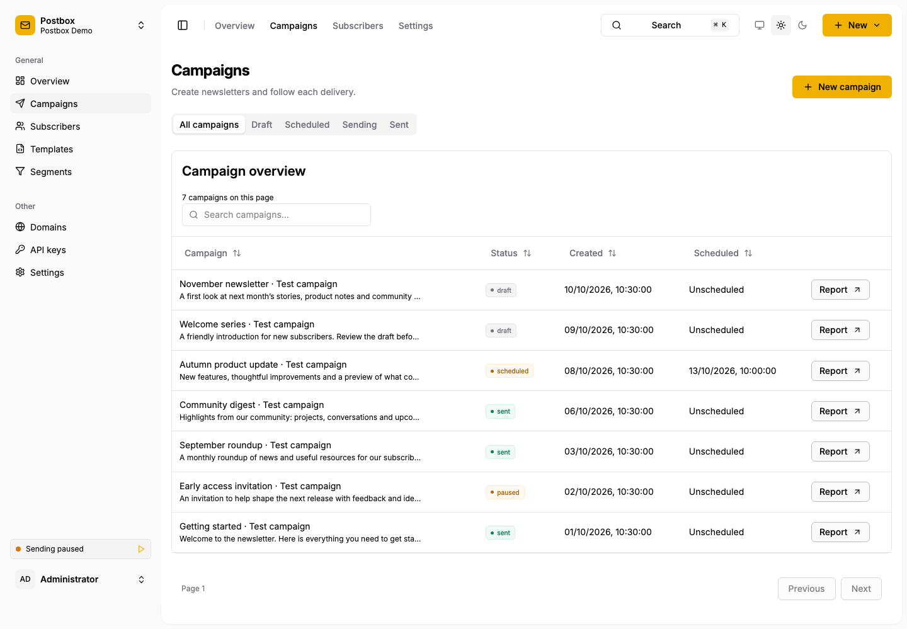

# Postbox

Postbox is a self-hosted newsletter service using Amazon SES v2 and SQLite. A single Go binary embeds the React application and database migrations. Run it directly or with Docker. SQLite and durable jobs remove the need for a separate database or queue server; JavaScript is needed only when building the frontend. AWS SES delivers email, with optional SNS/SQS for delivery events.



Campaign overview using synthetic test campaign data, with sending paused.

- Multiple brands with separate members, SES credentials, subscriber consent and event processing.
- Lists, segments, custom fields, reusable templates and a source-preserving HTML email editor.
- Scheduled campaigns, live reports, click/open tracking and signed unsubscribe links.
- Double opt-in, brand marketing opt-outs, delivery suppressions and configurable public signup.
- Durable jobs for imports, exports, transactional mail, maintenance and online backups.
- Password/TOTP and passkey authentication, brand-scoped API credentials and Sendy migration.

## Quick start

Build with Go matching [go.mod](go.mod) and Bun 1.4.3:

```sh
make build
export POSTBOX_DB=./data/postbox.db
export POSTBOX_BASE_URL=http://localhost:8080
./bin/postbox init
```

Supply `POSTBOX_ADMIN_EMAIL`, `POSTBOX_ADMIN_PASSWORD` and `POSTBOX_ADMIN_TOTP` through a protected environment. The TOTP value is the base32 secret enrolled in your authenticator. Create the administrator, clear the bootstrap secrets, then start the local application:

```sh
./bin/postbox admin
unset POSTBOX_ADMIN_PASSWORD POSTBOX_ADMIN_TOTP
./bin/postbox serve --development --secure-cookies=false
```

Open <http://localhost:8080>. Sending starts disabled. Configure a brand's AWS keys and SES region under **Settings > Amazon SES**, review sending identities and consent, then enable sending in Settings.

After signing in, open **Documentation** in the sidebar or visit `/docs`. Searchable guides and the Scalar API reference are bundled into the binary, including their JavaScript, styles and images. The docs, their assets and the OpenAPI downloads require an active user session. The guides are authored in [docs/handbook](docs/handbook/welcome.md), with detailed references included at build time.

For production, use an HTTPS origin, secure cookies and a TLS reverse proxy. Start with [Getting started](docs/handbook/getting-started.md) or [Running Postbox](docs/handbook/running-postbox.md). Back up the database and its tracking/credential encryption secret together.

## Handbook

- [Welcome](docs/handbook/welcome.md): overview and where to start.
- [Getting started](docs/handbook/getting-started.md): installation, brand connection, domains and SES events.
- [Sending newsletters](docs/handbook/sending-newsletters.md): audiences, consent, content and delivery outcomes.
- [Running Postbox](docs/handbook/running-postbox.md): deployment, access, backups and configuration.
- [Moving from Sendy](docs/handbook/moving-from-sendy.md): preview, import, review and retry.
- [Development](docs/handbook/development.md): architecture, build, tests and performance evidence.

`make build` embeds the handbook and Scalar API reference in the binary. In the application, open `/docs` after signing in. README and MANUAL are entry points; edit `docs/handbook/*.md` to change the guide pages.
