# Postbox architecture

Postbox runs as one CGO-free Go binary. SQLite provides durable state and all queues. Embedded React assets provide the admin application. AWS SES v2 accepts raw MIME messages; SNS to SQS supplies durable delivery feedback. No Redis, PostgreSQL, SMTP transport, or SES stored templates are required.

## Package boundaries

| Package | Responsibility |
| --- | --- |
| `cmd/postbox` | Configuration, admin setup, process lifecycle, fake SES and load-test entry points |
| `internal/store` | Writer/reader connections, embedded schema migrations, transaction boundary, maintenance |
| `internal/render` | Prepare source once, compile merge slots, per-recipient rendering, MIME, email normalization |
| `internal/send` | Recipient snapshot, claims, quota refresh, rate control, workers, attempt journal, result batches |
| `internal/tracking/token` | Shared signed campaign/subscriber token encoding |
| `internal/tracking` | Open pixel, click redirect, web archive, immediate one-click unsubscribe |
| `internal/events` | SNS validation, SQS ingestion, idempotent feedback, suppressions and counters |
| `internal/contacts` | List membership, normalized upserts, CSV streams, safe segment expressions, double opt-in |
| `internal/jobs` | Durable leased jobs, retry scheduling, rollups, retention, backups and webhooks |
| `internal/migrate` | Sendy migration with retained source identity and suppression semantics |
| `internal/httpapi` | Auth, sessions, TOTP, CSRF, brand scopes, JSON API, OpenAPI and SSE |
| `internal/web` | Embedded Bun-built React UI |

Other packages own their SQL. They receive `*store.DB`, perform reads through `Reader`, and use `Immediate` for writes that depend on state or change several rows. They never create a second writable pool.

## Sending pipeline

```mermaid
flowchart LR
    A[Scheduled or manual start] --> B[Quota and pre-send checks]
    B --> C[Prepare and persist immutable source and envelope]
    C --> D[INSERT SELECT recipient snapshot]
    D --> E[Claim pending keyset batch in BEGIN IMMEDIATE]
    E --> F[Bounded render channel]
    F --> G[Render snapshot values and build MIME]
    G --> H[Account token bucket]
    H --> I[Bounded worker pool]
    I --> J[Persist attempt before SES request]
    J --> K[SES v2 SendEmail Raw]
    K --> L[Bounded result channel]
    L --> M[Single batched result writer]
    M --> N[Recipient result and campaign counters commit]
    Q[GetAccount periodic refresh] --> H
    R[SNS to SQS feedback] --> S[Atomic event dedup and aggregates]
    S --> N
    S --> T[Suppress and skip pending recipients]
```



Preparation persists transformed subject, HTML and plain text, fixed date values, tracked links, and the sender envelope. Recipient snapshot columns freeze email, name and JSON fields so an edited profile cannot change the sent web version. Personalized web rendering uses that source and snapshot with the same renderer. Link IDs are stable campaign-local values mapped to durable global `links.id` rows.

Claims commit before delivery to rendering. The claimer advances by subscriber ID with bounded in-flight work. Each attempt is journaled before contacting SES because an interrupted or timed-out call may have been accepted. Results update recipients, campaign statistics and send-hour rollups in one transaction. An uncertain attempt is terminal `unknown`; it is never automatically retried or manually resent. This preserves the at-most-once delivery policy when SES may have accepted a request. Unsubscribe and suppression prevent additional pending claims. Graceful shutdown stops claiming, drains in-flight requests, and flushes results before closing SQLite.

The quota comes from SES GetAccount at campaign start and periodically thereafter. One account limiter counts messages, caps its burst at one second of account quota, and adjusts live. Concurrency follows observed latency with a cap. Throttle feedback lowers effective rate with jittered backoff, then recovers toward the account limit. Daily quota checks precede sending. Kill-switch, pause, cancel and account-level suspension stop further starts.

## SQLite connection contract

`store.Open(path)` opens a dedicated writer with one physical connection and a separate reader pool with eight connections. Each physical connection receives the following settings through repeated driver `_pragma` URI parameters, so replacement and newly opened pooled connections retain them:

```sql
PRAGMA journal_mode = WAL;
PRAGMA synchronous = NORMAL;
PRAGMA foreign_keys = ON;
PRAGMA busy_timeout = 5000;
PRAGMA temp_store = MEMORY;
PRAGMA cache_size = -65536;
PRAGMA mmap_size = 268435456;
```

Reader connections additionally enable `query_only`. WAL requires a file database; tests use temporary files instead of `:memory:`. `Immediate` owns a writer connection, starts `BEGIN IMMEDIATE`, executes a callback, and commits. Errors, cancellation and panics trigger rollback with a separate bounded cleanup context. Pool configuration serializes writers while WAL permits concurrent readers.

Migrations are embedded, ordered by filename, and applied atomically. `schema_migrations` stores each filename, SHA-256 checksum and application timestamp. Reopening validates already-applied checksums. Released migration files are immutable; schema changes belong in new files. Run `Analyze` after substantial imports and `Optimize` periodically. `Close` runs optimize before closing the pools. All timestamps and dates are INTEGER Unix milliseconds. Emails are normalized before insertion, preserving indexed exact comparisons.

## Final database schema

The executable DDL is the authoritative schema: [001_initial.sql](../internal/store/migrations/001_initial.sql) contains the base tables; [002_durability.sql](../internal/store/migrations/002_durability.sql) supplies preparation, recovery, aggregation, opt-in, audit and migration additions. [003_counter_snapshots.sql](../internal/store/migrations/003_counter_snapshots.sql) adds daily counter baselines and failed-job pagination; [004_snapshot_guard.sql](../internal/store/migrations/004_snapshot_guard.sql) records whether the immutable recipient snapshot has committed; [005_user_limits.sql](../internal/store/migrations/005_user_limits.sql) adds campaign ownership, per-user/per-brand daily limits and reservations, and pending TOTP enrollment secrets. All tables, including metadata, are STRICT. Composite relationship and rollup tables are WITHOUT ROWID. JSON fields have validity constraints. No event-table foreign-key cascade can accidentally delete a large event history.

| Tables | Durable contents and relationships |
| --- | --- |
| `brands` | Sender identity, reply-to, SES configuration set, unique tracking domain |
| `custom_fields` | Brand-owned typed field definitions and filterability; unique brand/key |
| `subscribers` | Brand-owned normalized email, generated domain, name, JSON fields, delivery status, consent and soft bounce count; unique brand/email |
| `lists`, `list_subscribers` | Brand list configuration; list/subscriber composite membership with subscribed, unconfirmed and unsubscribed states |
| `segments` | Brand-owned JSON rule definitions |
| `suppressions` | Email/domain exclusions with optional brand scope; NULL brand is global; scope-aware unique expression index |
| `templates` | Brand-owned full HTML document source |
| `campaigns`, `campaign_targets` | Lifecycle and schedule, source HTML/subject/text; typed include/exclude list and segment references |
| `campaign_recipients` | Campaign/subscriber queue key; state, attempt count, MessageId, errors, engagement timestamps, immutable email/name/fields snapshot |
| `campaign_preparations` | Campaign primary key; prepared subject/HTML/text, from-name/email, reply-to, configuration set, full tracking URL, JSON field list, prepared timestamp and recipient-snapshot completion marker |
| `send_attempts` | Integer primary key; campaign/subscriber/attempt unique identity; start, finish, outcome, error and returned MessageId |
| `campaign_stats` | One row per campaign; recipients, sent, failed, unknown, skipped, delivered, opens/clicks totals and unique human counts, unsubscribes, bounce categories and complaints |
| `links`, `link_stats`, `recipient_link_stats` | Campaign URL identity; preaggregated link totals and human/unique counts; per-recipient first-click and human-click markers |
| `opens`, `clicks`, `ses_events` | Raw activity without FK cascades; SNS envelope deduplication and SES MessageId matching |
| `campaign_countries`, `engagement_hourly` | Country and activity-over-time campaign aggregates |
| `list_counters`, `list_counter_snapshots`, `list_daily_stats`, `send_hourly` | Current membership counters, historical growth snapshots, brand send-volume rollups |
| `jobs` | Queue, JSON payload, due timestamp, status, attempt count, lease deadline and error |
| `webhooks` | Brand endpoints, selected JSON event types, signing secret and active flag |
| `users`, `user_brands` | Login credential hashes, TOTP and role; brand-scoped JSON permissions |
| `user_brand_daily`, `campaign_user_reservations` | Daily reserved recipient budget by user and brand; per-campaign reservation records |
| `totp_pending` | Short-lived TOTP enrollment secret linked to the enrolling session |
| `sessions`, `api_keys` | Hashed session tokens, CSRF hash and expiry; prefix/hash API credentials with scopes and revocation |
| `settings` | Persisted key/value settings including the global sending switch |
| `subscription_confirmations` | Hashed one-use list/subscriber confirmation tokens and expiry |
| `subscriber_activity` | Raw subscriber audit timeline, retained and erased in batches |
| `audit_log` | Admin action, entity and JSON detail; user/brand references become NULL when deleted |
| `migration_identities`, `migration_records` | Sendy source identity mapping and retained JSON records with composite source/entity/source-id key |
| `schema_migrations` | Applied filename, checksum and timestamp |

`campaign_targets.target_id` is polymorphic and therefore has no SQL foreign key. Target validation must check both type and brand before inserting. Raw activity IDs deliberately have no SQL foreign keys and are erased through indexed background batches. All declared foreign-key columns have a full leading index or primary-key coverage, verified from SQLite metadata in tests.

## Index rationale and query discipline

| Workload | Indexes or access path |
| --- | --- |
| Recipient claimer | Partial `campaign_recipients_pending(campaign_id,subscriber_id)`; exact pending predicate and keyset |
| Crash recovery | Partial `campaign_recipients_claimed(campaign_id)` and unfinished attempts index |
| Result application | Composite recipient primary key and campaign-stat integer primary key |
| Feedback association | Unique non-null MessageId recipient index; SNS message uniqueness and SES message index |
| Brand email lookup | Unique `subscribers_brand_email`; global feedback email lookup uses `subscribers_email` |
| Domain suppression | `subscribers_brand_domain` and scope-aware suppression kind/value expression index |
| Contacts and campaigns | `(brand_id,id)` indexes for keyset views; created-at indexes for time-based ordering |
| Membership snapshot | Partial `list_subscribers_active(list_id,subscriber_id)` plus subscriber primary-key lookup |
| Subscription changes | Subscriber-leading membership index and subscriber-leading recipient index |
| Segment counts | Brand-leading indexes; dynamic `(brand_id, fields ->> '$.key')` expression indexes with exactly matching segment expressions |
| Failed and unknown recipient pages | `campaign_recipients_status(campaign_id,status,subscriber_id)` |
| Due work | Partial campaigns due, jobs due and running lease indexes |
| Reports | Campaign stats, link stats, country/hourly/daily composite rollup primary keys |
| Subscriber timelines | Subscriber/time raw open and click indexes; subscriber/id activity index |
| Raw retention | Open and click `(at,id)` indexes, SES at index; bounded id/keyset deletions |
| FK cascades | Full leading relationship indexes, including subscriber side of composite keys |
| Session and token cleanup | Expiry indexes; user/session and confirmation-list/subscriber indexes |

For a selective filterable field, the segment-count plan test uses a safely chosen explicit expression index. SQLite can otherwise prefer a brand-only index despite the matching expression; segment compilation should choose an index from validated metadata when its filter shape permits it.

Queries never use OFFSET. Raw event scans do not power dashboard pages. Large imports stream input and batch prepared upserts, then run ANALYZE. Retention keeps aggregate totals and recipient first-event markers. Raw opens may be dropped only when the ingestion channel is full, with a metric; clicks and unsubscribe actions retain their integrity. One-click unsubscribe persists before HTTP success.

## Verification

`go test ./internal/store` verifies migration reopening, STRICT tables, reader write rejection, settings on four simultaneous reader connections, foreign-key enforcement, rollback on callback errors and panics, and index coverage for every declared FK. EXPLAIN QUERY PLAN cases cover claims, results, recipient snapshots, MessageId/email lookups, contact/list pagination, expression-index segment counts, campaign/recipient reports, due jobs/campaigns, raw timelines, SES lookups and pending skips. Each case rejects an unindexed full scan of a large subscriber, membership, recipient or raw-event table and requires an index access path.

Sender rate and rendering performance must be measured separately against fake SES before claiming production-scale proof. Full 350k load tests are currently running; no final performance results are available yet. Report achieved rate, latency distribution, process memory/CPU, and writer latency at the requested account rates only after those runs finish.
