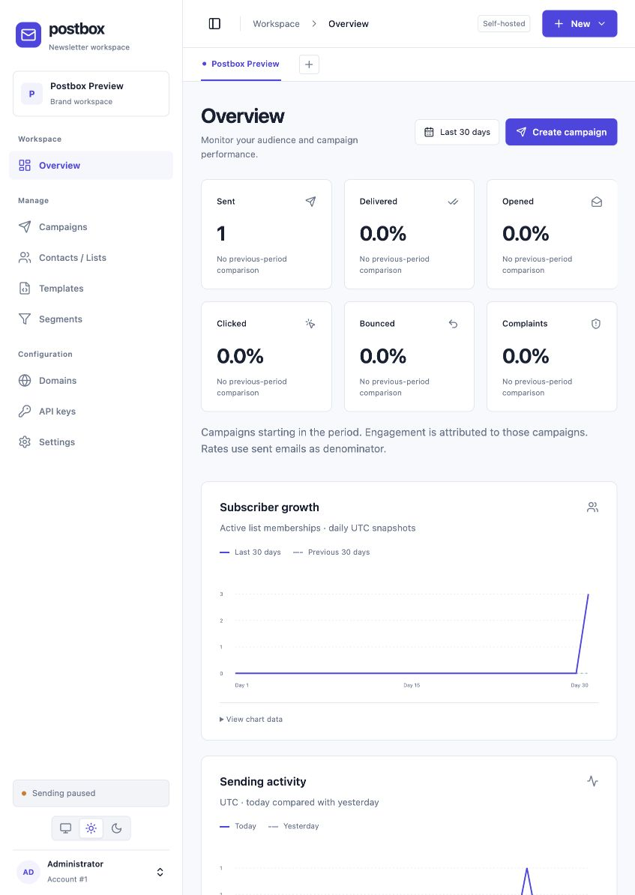

# Validation

Validated on 10 October 2026 with Go 1.27.1 and Bun 1.4.2 on an Apple M1 Pro
(macOS arm64).

## Automated checks

- `make test`: frontend preservation/theme tests and all Go packages.
- `make race`: all Go packages with the race detector.
- `go vet ./...`.
- Frozen Bun install, TypeScript checks and production frontend build.
- CGO-free, statically linked Linux amd64 and arm64 builds with the final
  embedded frontend.
- Query-plan tests inspect production SQL, including dispatch completion,
  recipient claims, audience snapshots, contact search and suppression scopes.
- Authentication tests use a signed ES256 virtual authenticator and cover
  WebAuthn origin, RP, user verification, challenges, replay, counters,
  ownership and session revocation, alongside TOTP and CSRF checks.
- CLI tests exercise first setup, persisted sending state, admin creation,
  backups, Sendy dry-run/idempotency, real SDK credential signing, missing
  credentials, health and SIGTERM shutdown.

Full campaign measurements and microbenchmark scope are recorded in
[performance-profile.md](performance-profile.md). Those measurements use the
real SES v2 HTTP adapter against fake SES, with a 100KB template and 350,000
recipients. They do not constitute a live AWS delivery test.

## Browser checks

The embedded Go application ran at `http://localhost:8080` with an isolated
test database and a loopback fake SES endpoint. Browser checks covered:

- TOTP sign-in, brand creation and sender identity settings.
- Contact creation, recorded consent and explicit list subscription.
- CSV mapping, dry-run, import and authenticated export, including quoted names.
- Segment creation and live count preview.
- Campaign audience selection, personalized Go-rendered preview and preflight.
- Two deliberate test requests to the same address and one campaign delivery:
  three fake acceptances, with one address deduplicated within each test request.
- Completed campaign report and connected SSE updates.
- Full-document template save, visual discard, visible source diff, and
  preserved head styles and Outlook conditional comments.
- Both the visible and hidden GrapesJS canvases are sandboxed before rendering.
- List-specific page settings persist and inherit defaults correctly.
- System, Light and Dark icon controls select the theme. Bootstrap tests cover
  first paint and saved preferences; System subscribes to OS appearance changes.
- Settings, account security and the API-key page load without browser errors.
- The refreshed admin UI has grouped navigation, a persisted collapse rail,
  semantic status badges, Radix action menus and slate/indigo light/dark themes.
- Contact email-prefix filtering returns real backend results; list and campaign
  menus support keyboard dismissal, and campaign reports retain connected SSE.
- At 390px mobile width, account navigation closes the focus-trapped sheet.
  At 640px by 360px, the sidebar scrolls to expose its account/theme controls.
  Temporary viewport overrides were reset after these checks.

Physical passkey enrollment and live AWS infrastructure were not exercised.
The preview stays configured for fake SES with global sending disabled.

